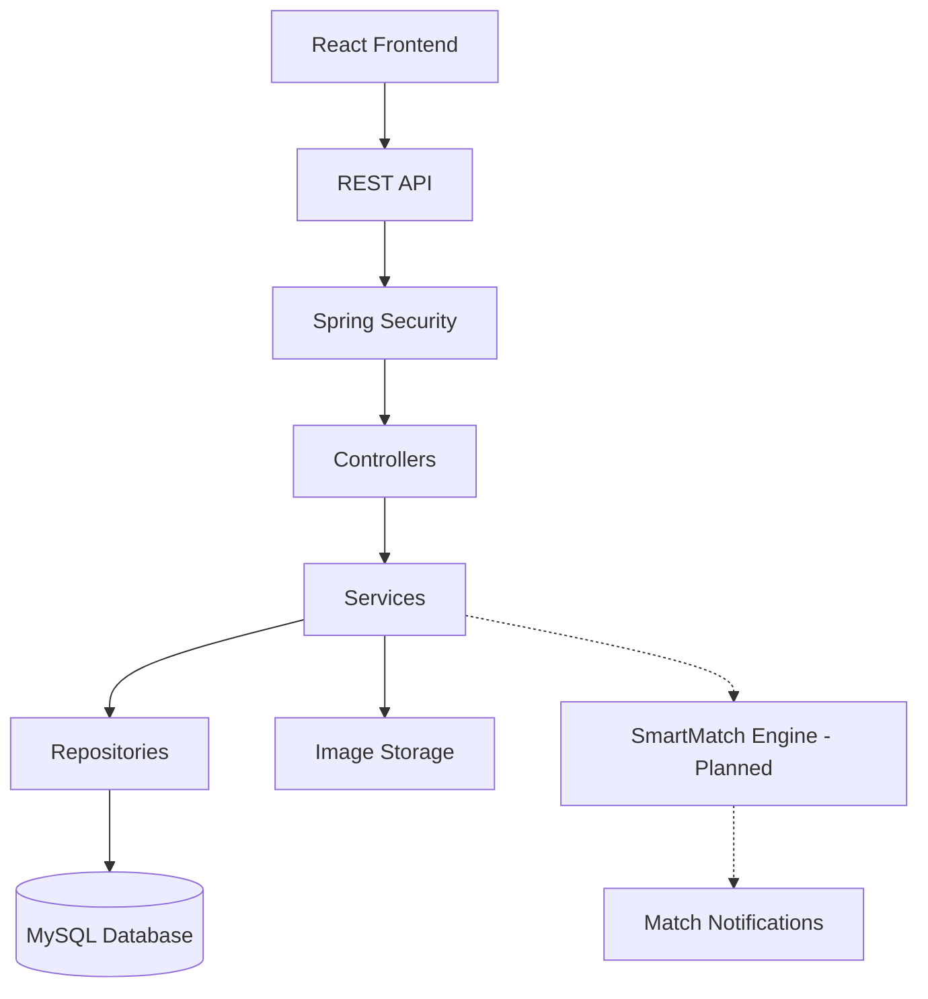

# 🔎 Lost & Found Bangladesh

### An Intelligent Nationwide Lost & Found Recovery Platform

Lost & Found Bangladesh is an open-source platform designed to help people report, discover, and recover lost belongings across Bangladesh.

The platform aims to connect lost items with their rightful owners using intelligent search, geographical information, automated matching, and secure ownership verification.

> **Our Mission:** Make returning lost belongings easier, faster, and safer—regardless of their monetary value.

**Project Status:** Active Development
**Current Version:** Backend MVP
**Backend:** Java, Spring Boot
**Frontend:** React
**Database:** MySQL

---

## 1. Overview

Every day, people lose important belongings such as identity cards, certificates, wallets, keys, documents, and personal items.

Existing recovery methods often depend on scattered social media posts, local communities, and manual searching.

Lost & Found Bangladesh aims to solve this problem through a centralized recovery platform.

The system focuses on three principles:

- **Discover:** Find relevant lost and found reports.
- **Match:** Automatically identify potential connections between reports.
- **Recover:** Verify ownership and facilitate safe returns.

An item may have little market value but enormous personal importance to its owner.

Our goal is to help recover those belongings.

---

## 2. Features

### ✅ Currently Implemented

- User registration and login
- JWT-based authentication
- Lost and found item reporting
- Item image uploads
- Public item browsing
- Item details and management
- Ownership claims
- Claim approval and rejection endpoints
- In-app notifications
- User-specific authorization
- REST API
- MySQL persistence
- Docker-based deployment

### 🚧 Planned Improvements

- Unified search with advanced filters
- Interactive map-based location selection
- Nearby lost and found discovery
- SmartMatch automatic matching engine
- Explainable matching scores
- Automatic match notifications
- Secure ownership verification
- Complete item recovery workflow
- Bangla and English search
- Administrative moderation
- Recovery analytics

### 🔮 Future Features

- AI-powered semantic matching
- Image similarity detection
- OCR-assisted document identification
- JourneyMatch: Route-based lost item discovery
- Verified institutional recovery centers
- Mobile applications

Planned features are documented in `docs/` and are not necessarily available in the current API.

---

## 3. Technology Stack

| Component        | Technology                 |
| ---------------- | -------------------------- |
| Backend          | Java 21, Spring Boot       |
| Frontend         | React                      |
| Database         | MySQL                      |
| ORM              | Spring Data JPA, Hibernate |
| Security         | Spring Security, JWT       |
| Image Processing | Java Image Processing      |
| Maps (Planned)   | Leaflet, OpenStreetMap     |
| API              | REST / JSON                |
| Build Tool       | Maven                      |
| Containerization | Docker                     |
| Testing          | JUnit, Spring Boot Test    |
| Version Control  | Git, GitHub                |

---

## 4. System Architecture

The application follows a layered architecture.



### Request Processing

```text
Client Request
     ↓
Spring Security
     ↓
Controller
     ↓
Service
     ↓
Repository
     ↓
Database
     ↓
API Response
```

Controllers handle HTTP requests, services implement business logic, and repositories manage database operations.

See [System Architecture](docs/03-ARCHITECTURE.md).

---

## 5. Project Structure

```text
lostfound/
│
├── backend/                  # Spring Boot backend
│   ├── src/
│   ├── pom.xml
│   ├── mvnw
│   └── Dockerfile
│
├── fronend/                  # Frontend directory (rename planned)
│
├── docs/                     # Engineering documentation
│
├── compose.yaml              # Docker Compose configuration
├── docker-entrypoint.sh      # Container startup script
├── render.yaml               # Render deployment configuration
├── DEPLOYMENT.md             # Existing deployment instructions
└── README.md                 # Project documentation
```

The frontend directory is currently named `fronend`. It can be renamed to `frontend` after updating any dependent configurations.

---

## 6. Getting Started

### Prerequisites

- Java 21
- Docker and Docker Compose
- MySQL
- Node.js and npm
- Git

### Clone Repository

```bash
git clone https://github.com/gr309/lost-and-found.git

cd lost-and-found
```

### Backend Setup

Navigate to the backend:

```bash
cd backend
```

Configure the required environment variables according to the deployment documentation.

Run the backend using Maven:

```bash
./mvnw spring-boot:run
```

The default backend URL is:

```text
http://localhost:8080
```

Health check:

```bash
curl http://localhost:8080/health/
```

The application requires a correctly configured database and JWT signing secret before startup.

### Docker Deployment

From the repository root:

```bash
docker compose up --build
```

Docker environment variables and database credentials must be configured before running the services.

For complete instructions, see [Deployment Guide](DEPLOYMENT.md).

### Frontend Setup

Navigate to the current frontend directory:

```bash
cd fronend
```

Install dependencies:

```bash
npm install
```

Start the development server:

```bash
npm run dev
```

Configure the frontend API URL according to the frontend application's environment configuration.

---

## 7. API Overview

**Local Base URL:** `http://localhost:8080`

| Method | Endpoint                             | Description            |
| ------ | ------------------------------------ | ---------------------- |
| POST   | `/api/auth/signup/`                | Register user          |
| POST   | `/api/auth/signin/`                | Login                  |
| GET    | `/api/user/me`                     | Current user profile   |
| GET    | `/api/items/`                      | List reports           |
| GET    | `/api/items/{id}/`                 | Get report             |
| POST   | `/api/items/`                      | Create report          |
| PUT    | `/api/items/{id}/`                 | Update report          |
| DELETE | `/api/items/{id}/`                 | Delete report          |
| POST   | `/api/claims/`                     | Submit claim           |
| GET    | `/api/claims/`                     | My claims              |
| POST   | `/api/claims/{id}/approve/`        | Approve claim          |
| POST   | `/api/claims/{id}/reject/`         | Reject claim           |
| GET    | `/api/notifications/`              | My notifications       |
| GET    | `/api/notifications/unread-count/` | Unread count           |
| PATCH  | `/api/notifications/{id}/read/`    | Mark notification read |
| PATCH  | `/api/notifications/read-all/`     | Mark all read          |

Protected endpoints require:

```http
Authorization: Bearer <accessToken>
```

Item creation accepts `multipart/form-data` with an optional image.

**Note:** The current API does not yet support unified search, geographical search, or SmartMatch.

See [API Documentation](docs/05-API.md).

---

## 8. SmartMatch — Intelligent Matching Engine

SmartMatch is a planned feature that automatically identifies potential matches between lost and found reports.

### Matching Factors

| Factor              | Initial Weight |
| ------------------- | -------------: |
| Category            |            20% |
| Item Title          |            20% |
| Description         |            20% |
| Item Attributes     |            15% |
| Geographic Location |            15% |
| Date and Time       |            10% |

The system will calculate a similarity score and recommend relevant reports.

```text
New Lost/Found Report
         ↓
Candidate Retrieval
         ↓
Similarity Calculation
         ↓
Match Ranking
         ↓
Potential Matches
         ↓
User Notification
```

Matching scores indicate similarity, not verified ownership.

See [SmartMatch Design](docs/07-SMARTMATCH.md).

---

## 9. Nationwide Geographic Search

The planned location system will support:

- Selecting locations on interactive maps
- Searching by district, area, or locality
- Discovering reports within a selected radius
- Calculating geographical distance
- Finding geographically relevant lost/found reports
- Protecting sensitive location information

The initial geographic search implementation will use structured location data and geographical coordinates.

Future versions may introduce route-based discovery for belongings lost during travel.

---

## 10. Security

The application implements authentication and resource ownership checks.

Security features and requirements include:

- JWT authentication
- Password hashing
- Protected API endpoints
- Report ownership validation
- User-scoped claims and notifications
- Request validation
- Secure configuration management

Planned improvements include stronger ownership verification, moderation, sensitive document protection, and abuse prevention.

See [Security Documentation](docs/08-SECURITY.md).

---

## 11. Documentation

Complete engineering documentation is available in the `docs/` directory.

| Document                                               | Description                                |
| ------------------------------------------------------ | ------------------------------------------ |
| [Engineering Overview](docs/00-ENGINEERING-OVERVIEW.md) | Complete project specification             |
| [Requirements](docs/01-REQUIREMENTS.md)                 | Functional and nonfunctional requirements  |
| [User Flows](docs/02-USER-FLOWS.md)                     | User journeys and workflows                |
| [Architecture](docs/03-ARCHITECTURE.md)                 | System components and data flow            |
| [Database Design](docs/04-DATABASE.md)                  | Entities, relationships, and constraints   |
| [API Documentation](docs/05-API.md)                     | Endpoints, requests, and responses         |
| [Codebase Guide](docs/06-CODEBASE.md)                   | Classes, methods, and responsibilities     |
| [SmartMatch](docs/07-SMARTMATCH.md)                     | Intelligent matching engine                |
| [Security](docs/08-SECURITY.md)                         | Authentication, authorization, and privacy |
| [Testing](docs/09-TESTING.md)                           | Testing strategy and quality assurance     |
| [Deployment](docs/10-DEPLOYMENT.md)                     | Environment configuration and deployment   |

### Existing Backend Reference

The original backend documentation can be preserved as:

[Backend Reference](docs/BACKEND-REFERENCE.md)

This reference describes currently implemented endpoints, internal methods, data models, and known limitations.

---

## 12. Development Roadmap

| Phase | Focus                              | Status      |
| ----- | ---------------------------------- | ----------- |
| 1     | Backend MVP                        | Implemented |
| 2     | Nationwide Location Infrastructure | Planned     |
| 3     | Unified Search                     | Planned     |
| 4     | SmartMatch V1                      | Planned     |
| 5     | Secure Recovery Workflow           | Planned     |
| 6     | Advanced AI Matching               | Future      |
| 7     | Nationwide Production Expansion    | Future      |

Development priorities may change based on testing, user feedback, and technical requirements.

---

## 13. Testing

Run backend tests:

```bash
cd backend

./mvnw test
```

Run build verification:

```bash
./mvnw verify
```

All critical workflows should be verified before production releases.

See [Testing Documentation](docs/09-TESTING.md).

---

## 14. Contributing

Contributions, bug reports, and improvement suggestions are welcome.

Before contributing:

1. Review the project documentation.
2. Follow the existing code architecture.
3. Keep changes focused and maintainable.
4. Add or update relevant tests.
5. Update documentation when behavior changes.

---

## 15. Project Links

**GitHub:** https://github.com/gr309/lost-and-found

**Backend API:** 

**Frontend:**

The current public frontend is an earlier university-focused implementation. The nationwide platform is under development.

Free-tier deployments may experience startup delays.

---

## 16. Project Vision

Lost & Found Bangladesh aims to become a reliable national recovery network connecting people with their lost belongings.

The project's success will be measured not only by reports and matching accuracy but by how many belongings are successfully returned to their rightful owners.

**Find. Match. Recover.**

*Connecting lost belongings with their rightful owners—anywhere in Bangladesh.*
