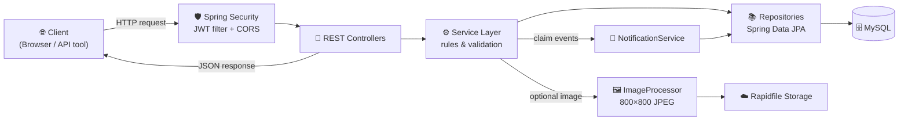
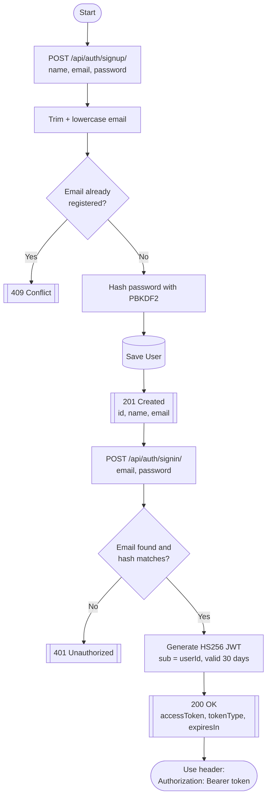
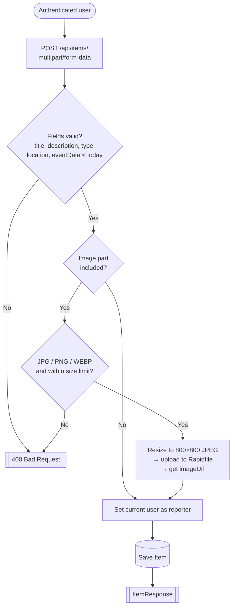
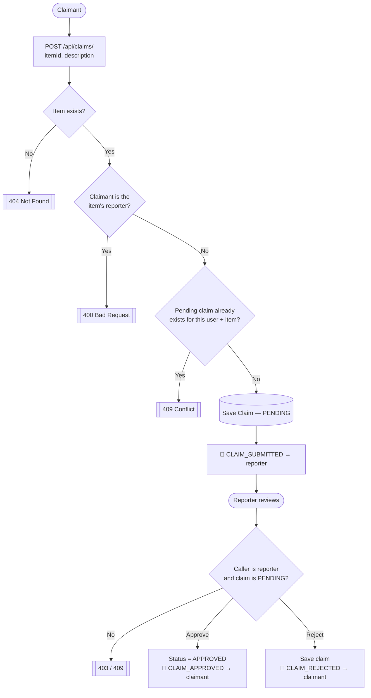
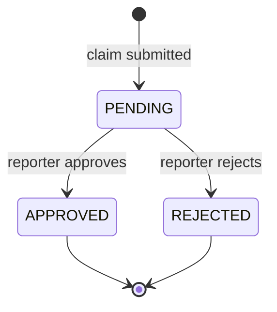
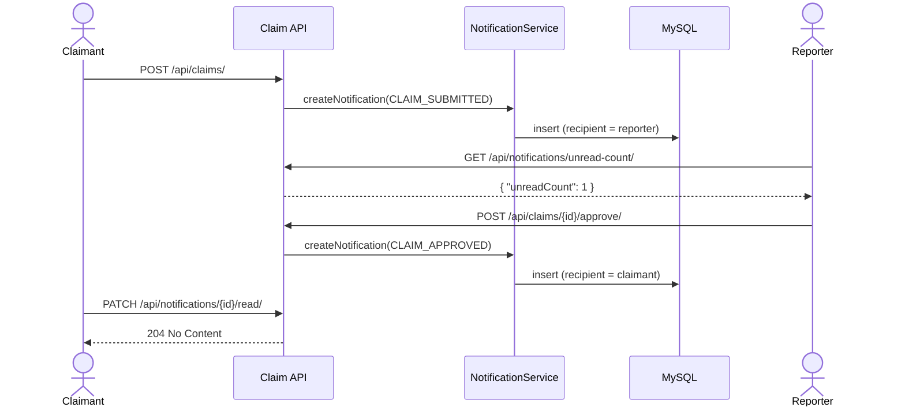
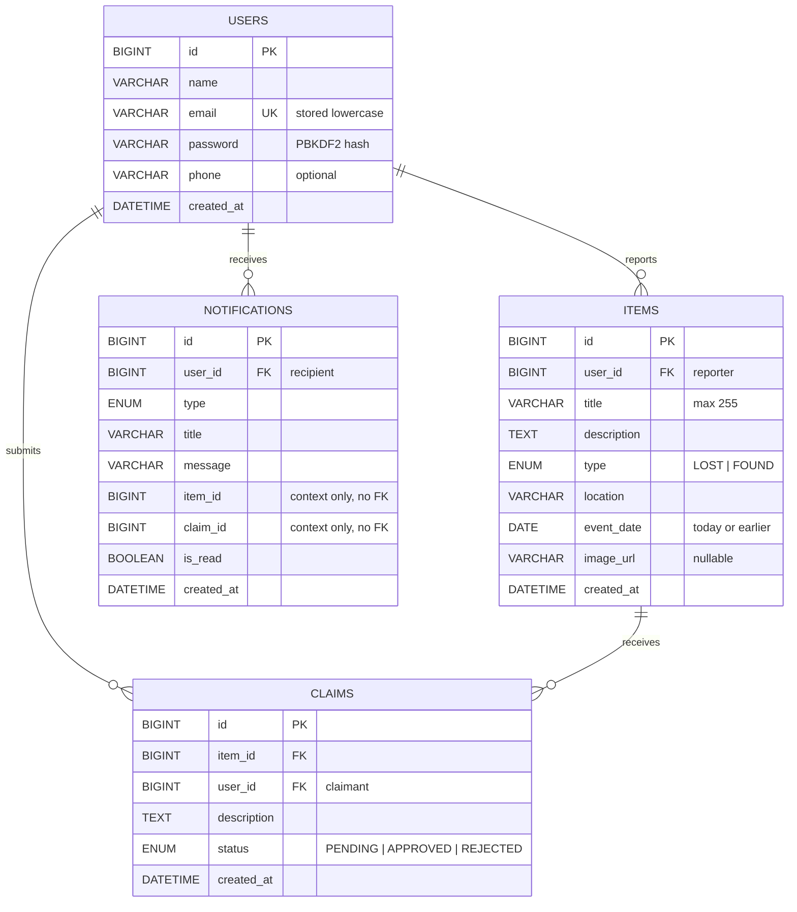

# 🔎 Lost & Found API

> A RESTful backend, built with Spring Boot, that lets people post lost or found belongings, claim items that belong to them, review incoming claims, and receive in-app alerts as claims progress.

This document describes the system **exactly as it is implemented today**. Features that are absent from the code (search, categories, refresh tokens, password reset, match/resolve notifications) are intentionally not described as available.

---

## 📑 Table of Contents

1. [Overview](#1-overview)
2. [Tech Stack](#2-tech-stack)
3. [Codebase Layout](#3-codebase-layout)
4. [Architecture](#4-architecture)
5. [Core Workflows (Flowcharts)](#5-core-workflows-flowcharts)
6. [Data Model (ER Diagram)](#6-data-model-er-diagram)
7. [Endpoint Catalogue](#7-endpoint-catalogue)
8. [Payload Reference](#8-payload-reference)
9. [Request Processing Path](#9-request-processing-path)
10. [Component Reference](#10-component-reference)
11. [Rules, Validation & Errors](#11-rules-validation--errors)
12. [Known Limitations](#12-known-limitations)
13. [Getting Started](#13-getting-started)
14. [Try It with cURL](#14-try-it-with-curl)

---

## 1. Overview

The platform covers the full lifecycle of a misplaced item: someone reports it, another person claims it, and the original reporter decides on the claim.

**What the service can do**

| Area | Capability |
| --- | --- |
| Accounts | Register and log in; passwords are stored as PBKDF2 hashes. |
| Security | Stateless authentication based on signed JWTs; CORS support for browser front-ends. |
| Items | Anyone can browse all reports or open a single one. Logged-in users can post a report with an optional photo. |
| Ownership | Editing and removing a report is allowed only for the user who created it. |
| Claims | A single claim model serves both `LOST` and `FOUND` reports. Claims can be listed, approved, or rejected. |
| Notifications | Alerts are generated when a claim is submitted, approved, or rejected. Users can list alerts, see an unread total, and mark one or all as read. |

---

## 2. Tech Stack

| Concern | Technology |
| --- | --- |
| Language / runtime | Java 21 |
| Framework | Spring Boot 4.1.2, Spring Web MVC |
| Persistence | Spring Data JPA, Hibernate, MySQL (Connector/J) |
| Validation | Jakarta Bean Validation |
| Security | Spring Security OAuth2 Resource Server + JWT (HS256), PBKDF2 encoder |
| Build | Maven Wrapper |
| Container | Docker on Eclipse Temurin 21 |
| Media | Rapidfile-compatible storage via `RapidfileStorageService` |

---

## 3. Codebase Layout

```text
src/main/java/com/learn/lostfound/
├── LostfoundApplication.java   → bootstraps Spring Boot
├── controller/                 → REST endpoints & request binding
├── service/                    → business logic & orchestration
├── repository/                 → Spring Data interfaces
├── entity/                     → JPA-mapped tables
├── dto/                        → request / response contracts
├── enums/                      → item, claim & notification states
├── config/                     → security, JWT, hashing, static files
└── exception/                  → global REST error handling
```

**Responsibilities by layer**

| Layer | What it owns |
| --- | --- |
| Controller | URL/verb mapping, reading JSON or multipart input, extracting the JWT subject, shaping HTTP responses. |
| Service | Ownership checks, business decisions, persistence steps, image handling, firing notifications. |
| Repository | `JpaRepository` extensions; queries derived from method names. |
| Entity | Table mappings for `User`, `Item`, `Claim`, `Notification`. |
| DTO | Public input/output shapes — never leak passwords or entity relations. |
| Config | JWT encode/decode, password encoder, CORS, static upload handling, security filter rules. |
| Exception | Turns `ResponseStatusException` into a uniform `{ "message": "..." }` body. |

---

## 4. Architecture



**How identity flows:** on successful login the server issues a JWT whose `sub` claim holds the user's numeric ID. Protected controllers read that subject, convert it to `Long`, and hand it to the service layer — so every ownership decision is based on the token, never on client-supplied IDs.

---

## 5. Core Workflows (Flowcharts)

### 5.1 Registration & Login



### 5.2 Reporting an Item



### 5.3 Claim Review Process



> ⚠️ See [Known Limitations](#12-known-limitations): the reject path currently does not set the status to `REJECTED`.

### 5.4 Claim State Machine (intended design)



### 5.5 Notification Handling



---

## 6. Data Model (ER Diagram)



**Relationship notes**

- True JPA foreign keys: `items.user_id`, `claims.item_id`, `claims.user_id`, `notifications.user_id`.
- `notifications.item_id` and `notifications.claim_id` are plain reference columns that give context to the alert; they are **not** enforced as foreign keys.

**Enumerations**

| Enum | Values |
| --- | --- |
| `ItemType` | `LOST`, `FOUND` |
| `ClaimStatus` | `PENDING`, `APPROVED`, `REJECTED` |
| `NotificationType` | `CLAIM_SUBMITTED`, `CLAIM_APPROVED`, `CLAIM_REJECTED`, `ITEM_MATCHED`*, `ITEM_RESOLVED`* |

\* Declared but never produced by the current services.

---

## 7. Endpoint Catalogue

- **Base URL (local):** `http://localhost:8080`
- **Trailing slashes matter:** every route below ends with `/` **except** `/api/user/me`.
- **Auth legend:** 🌍 = no token needed · 🔐 = `Authorization: Bearer <accessToken>` · 👑 = 🔐 and must be the item's reporter

### System

| Verb | Path | Auth | Handler | Description |
| --- | --- | --- | --- | --- |
| GET | `/` | 🌍 | `HomeController.home` | Service status. |
| GET | `/health/` | 🔐* | `HomeController.health` | Returns `{ "status": "UP" }`. |

\* Protected because of a slash mismatch — see [Known Limitations](#12-known-limitations).

### Authentication & Profile

| Verb | Path | Auth | Handler | Description |
| --- | --- | --- | --- | --- |
| POST | `/api/auth/signup/` | 🌍 | `UserController.signup` | Create an account. |
| POST | `/api/auth/signin/` | 🌍 | `UserController.signin` | Check credentials, issue a JWT. |
| GET | `/api/user/me` | 🔐 | `UserController.me` | Current user's public profile. |

### Items

| Verb | Path | Auth | Handler | Description |
| --- | --- | --- | --- | --- |
| GET | `/api/items/` | 🌍 | `ItemController.getItems` | All item reports. |
| GET | `/api/items/{id}/` | 🌍 | `ItemController.getItem` | A single report. |
| POST | `/api/items/` | 🔐 | `ItemController.createItem` | New report (multipart). |
| PUT | `/api/items/{id}/` | 👑 | `ItemController.updatedItem` | Replace editable fields (JSON). |
| DELETE | `/api/items/{id}/` | 👑 | `ItemController.deleteItem` | Remove a report → `204`. |

### Claims

| Verb | Path | Auth | Handler | Description |
| --- | --- | --- | --- | --- |
| POST | `/api/claims/` | 🔐 | `ClaimController.createClaim` | File a claim. |
| GET | `/api/claims/` | 🔐 | `ClaimController.getMyClaims` | Claims I have filed. |
| POST | `/api/claims/{id}/approve/` | 👑 | `ClaimController.approveClaim` | Accept a pending claim. |
| POST | `/api/claims/{id}/reject/` | 👑 | `ClaimController.rejectClaim` | Decline a pending claim. |

### Notifications

| Verb | Path | Auth | Handler | Description |
| --- | --- | --- | --- | --- |
| GET | `/api/notifications/` | 🔐 | `NotificationController.getNotifications` | My alerts, newest first. |
| GET | `/api/notifications/unread-count/` | 🔐 | `NotificationController.getUnreadCount` | Number of unread alerts. |
| PATCH | `/api/notifications/{id}/read/` | 🔐 | `NotificationController.markAsRead` | Mark one of my alerts read → `204`. |
| PATCH | `/api/notifications/read-all/` | 🔐 | `NotificationController.markAllAsRead` | Mark all my alerts read → `204`. |

> **Not available:** category routes, item search, claim codes, refresh tokens, password reset, and any public "create notification" route. `NotificationService.createNotification` is internal and only invoked by the claim workflow.

---

## 8. Payload Reference

### 8.1 Authentication

**Signup** — request

```json
{ "name": "Alice", "email": "alice@example.com", "password": "ExamplePassword123!" }
```

**Signup** — `201 Created`

```json
{ "id": 1, "name": "Alice", "email": "alice@example.com" }
```

**Signin** — request

```json
{ "email": "alice@example.com", "password": "ExamplePassword123!" }
```

**Signin** — `200 OK`

```json
{ "accessToken": "<jwt>", "tokenType": "Bearer", "expiresIn": "30 days" }
```

Notes: `expiresIn` is a human-readable string, not seconds. Passwords never appear in any response.

### 8.2 Items

**`ItemRequest`**

| Field | Type | Constraint |
| --- | --- | --- |
| `title` | string | Mandatory, not blank, ≤ 255 chars |
| `description` | string | Mandatory, not blank |
| `type` | enum | `LOST` or `FOUND` |
| `location` | string | Mandatory, not blank |
| `eventDate` | ISO date (`YYYY-MM-DD`) | Mandatory, `@PastOrPresent` |
| `image` | file part | Create only, optional; JPG/PNG/WEBP; ≤ 5 MB |

**`ItemResponse`** → `id`, `title`, `description`, `type`, `location`, `eventDate`, `imageUrl`, `createdAt`

**Content types**

| Operation | Content-Type | Image handling |
| --- | --- | --- |
| Create (`POST`) | `multipart/form-data` — five text parts + optional `image` part | Processed and uploaded |
| Update (`PUT`) | `application/json` — the five text fields | Image is **not** changed |

### 8.3 Claims

**`ClaimRequest`**

```json
{ "itemId": 10, "description": "The wallet has my initials inside." }
```

**`ClaimResponse`** → `id`, `itemId`, `description`, `status` (`PENDING` / `APPROVED` / `REJECTED`), `createdAt`.
There is no `claimCode` field.

### 8.4 Notifications

**`NotificationResponse`** → `id`, `type`, `title`, `message`, `itemId`, `claimId`, `read`, `createdAt`

**Unread count**

```json
{ "unreadCount": 2 }
```

Both mark-as-read endpoints reply with `204 No Content` and an empty body.

---

## 9. Request Processing Path

| Operation | Call chain (Controller → Service → Repository → Entity) | Key checks / side effects |
| --- | --- | --- |
| Signup | `UserController.signup` → `UserService.signup` → `UserRepository.existsByEmail`, `saveAndFlush` → `User` | Normalise email, hash password, `409` on duplicate. |
| Signin | `UserController.signin` → `UserService.signin` → `UserRepository.findByEmail` → `User` | PBKDF2 match → JWT; else `401`. |
| Profile | `UserController.me` → `UserService.getUserById` → `UserRepository.findById` → `User` | ID from JWT; `404` if missing. |
| List items | `ItemController.getItems` → `ItemService.getAllItems` → `ItemRepository.findAll` → `Item` | Public; mapped to `ItemResponse`. |
| One item | `ItemController.getItem` → `ItemService.getItems` → `ItemRepository.findById` → `Item` | `404` if missing. |
| Create item | `ItemController.createItem` → `ItemService.createItem` → `UserRepository.findById`, `ItemRepository.save` → `User`, `Item` | Caller becomes reporter; image processed before save. |
| Update item | `ItemController.updatedItem` → `ItemService.updateItem` → `ItemRepository.findById`, `save` → `Item` | Non-owner → `403`. |
| Delete item | `ItemController.deleteItem` → `ItemService.deleteItem` → `ItemRepository.findById`, `delete` → `Item` | Non-owner → `403`; success → `204`. |
| Create claim | `ClaimController.createClaim` → `ClaimService.createClaim` → `ItemRepository`, `UserRepository`, `ClaimRepository.exists…`, `save` → `Item`, `User`, `Claim` | Own item → `400`; duplicate pending → `409`; notify reporter. |
| My claims | `ClaimController.getMyClaims` → `ClaimService.getMyClaims` → `ClaimRepository.findByUserId` → `Claim` | Only the caller's claims. |
| Approve | `ClaimController.approveClaim` → `ClaimService.approveClaim` → `ClaimRepository.findById`, `save` → `Claim` | Reporter + pending only; set `APPROVED`; notify claimant. |
| Reject | `ClaimController.rejectClaim` → `ClaimService.rejectClaim` → `ClaimRepository.findById`, `save` → `Claim` | Reporter + pending checks; saves **without** setting `REJECTED`; notifies claimant. |
| List alerts | `NotificationController.getNotifications` → `NotificationService.getNotifications` → `NotificationRepository.findByUserIdOrderByCreatedAtDesc` | User-scoped, newest first. |
| Unread count | `NotificationController.getUnreadCount` → `NotificationService.getUnreadCount` → `NotificationRepository.countByUserIdAndIsReadFalse` | User-scoped. |
| Mark one | `NotificationController.markAsRead` → `NotificationService.markAsRead` → `NotificationRepository.findByIdAndUserId`, `save` | Must own it; `404` otherwise; `204` on success. |
| Mark all | `NotificationController.markAllAsRead` → `NotificationService.markAllAsRead` → `NotificationRepository.findByUserIdOrderByCreatedAtDesc` | Flags every unread alert of the caller. |

---

## 10. Component Reference

### Entry point & controllers

| Class | Methods | Role |
| --- | --- | --- |
| `LostfoundApplication` | `main` | Launches the application. |
| `HomeController` | `home`, `health` | Status and health-style replies. |
| `UserController` | `signup`, `signin`, `me` | Auth and profile. |
| `ItemController` | `getItems`, `getItem`, `createItem`, `updatedItem`, `deleteItem` | Item CRUD, multipart intake. |
| `ClaimController` | `createClaim`, `getMyClaims`, `approveClaim`, `rejectClaim` | Claim workflow. |
| `NotificationController` | `getNotifications`, `getUnreadCount`, `markAsRead`, `markAllAsRead` | Alert reading. |

### Services

| Class | Methods | Role |
| --- | --- | --- |
| `UserService` | `signup`, `signin`, `getUserById` | Credential normalisation, hashing, user DTOs. |
| `JwtService` | `generateToken` | 30-day HS256 tokens with user ID as subject. |
| `ItemService` | `createItem`, `getAllItems`, `getItems`, `updateItem`, `deleteItem`, `toResponse` | Item persistence, ownership, mapping. |
| `ClaimService` | `createClaim`, `getMyClaims`, `approveClaim`, `rejectClaim`, `getClaimForReviewer`, `toResponse` | Claim rules and notification triggers. |
| `NotificationService` | `createNotification`, `getNotifications`, `getUnreadCount`, `markAsRead`, `markAllAsRead`, `toResponse` | Alert storage and per-user scoping. |
| `FileStorageService` | `save` | Storage abstraction for uploads. |
| `RapidfileStorageService` | `save` | Validate → process → upload → return public URL. |
| `ImageProcessor` | `process` | Validates, centres on an 800×800 white canvas, JPEG-compresses. |
| `LocalFileStorageService` | — | Inactive: body commented out, not registered as a bean. |

### Repositories

| Interface | Custom queries (plus standard CRUD) |
| --- | --- |
| `UserRepository` | `findByEmail`, `existsByEmail` |
| `ItemRepository` | none beyond `findAll`, `findById`, `save`, `delete` |
| `ClaimRepository` | `findByUserId`, `existsByItemIdAndUserIdAndStatus` |
| `NotificationRepository` | `findByUserIdOrderByCreatedAtDesc`, `countByUserIdAndIsReadFalse`, `findByIdAndUserId` |

---

## 11. Rules, Validation & Errors

### Business rules

- ✉️ Emails are trimmed and lowercased before the uniqueness check; a clash yields `409`.
- 👤 Only an item's reporter may edit it, delete it, or decide on its claims.
- 🚫 Users cannot claim items they reported themselves.
- 🔁 At most one `PENDING` claim per user per item; a second one yields `409`.
- 🔔 New claim → reporter is notified. Approval/rejection → claimant is notified.
- 🔒 Alerts are always fetched by the recipient ID taken from the JWT.

### Image rules

- Optional, and accepted only when creating an item.
- `RapidfileStorageService`: JPG, PNG, or WEBP, up to **5 MB**.
- `ImageProcessor`: additionally rejects anything over **10 MB** and always outputs JPEG.

### Security rules

- Public: `/`, signup, signin, `GET /api/items/`, `GET /api/items/{id}/`.
- Everything else requires a valid token.
- CORS: configured origins; methods `GET POST PUT PATCH DELETE OPTIONS`; headers `Authorization`, `Content-Type`, `Accept`.

### Error format

All handled errors share one shape:

```json
{ "message": "Item not found" }
```

| Status | Meaning in this API |
| --- | --- |
| `400` | Invalid input or business rule violated |
| `401` | Token missing/invalid, or wrong credentials |
| `403` | Authenticated but not the owner |
| `404` | Resource does not exist |
| `409` | Duplicate or already-processed state |
| `415` | Unsupported content type |
| `500` | Unexpected database or infrastructure failure |

---

## 12. Known Limitations

These reflect the current code and are listed so consumers are not surprised.

| # | Issue | Effect | Suggested fix |
| --- | --- | --- | --- |
| 1 | `rejectClaim` saves without `claim.setStatus(REJECTED)` | Claim remains `PENDING` while the claimant receives a "rejected" alert | Set the status before `save()` |
| 2 | Controller maps `/health/`, security allows `/health` | Health check needs a token | Align both paths (or permit both) |
| 3 | Signup/signin DTOs lack validation annotations and `@Valid` | Null fields may cause runtime errors instead of a clean `400` | Add `@NotBlank`/`@Email` and `@Valid` |
| 4 | `ITEM_MATCHED`, `ITEM_RESOLVED` unused | Enum values never appear in practice | Implement triggers or remove |
| 5 | No server-side search | Clients must filter the full list from `GET /api/items/` | Add query parameters / pagination |

---

## 13. Getting Started

### 13.1 Environment variables

Configuration is read from the environment by `application.properties`. **Never commit real secrets.**

| Variable | Required | Purpose (default) |
| --- | --- | --- |
| `DB_URL` | ✅ | JDBC URL, e.g. `jdbc:mysql://localhost:3306/lostfound` |
| `DB_USERNAME` | ✅ | Database user |
| `DB_PASSWORD` | ✅ | Database password |
| `JWT_SECRET` | ✅ | Base64 string that decodes to ≥ 32 bytes |
| `RAPIDFILE_SECRET_KEY` | ✅ (startup) | Rapidfile upload key |
| `PORT` | — | HTTP port (`8080`) |
| `CORS_ALLOWED_ORIGINS` | — | Comma-separated origins (`http://localhost:5173`) |
| `APP_ENV` | — | Active profile (`dev`) |
| `APP_DEBUG` | — | Debug toggle (`false`) |
| `APP_LOG_LEVEL` | — | App log level (`INFO`) |
| `SQL_DEBUG` | — | Hibernate SQL output (`false`) |

### 13.2 Database

Create a MySQL schema named `lostfound` and a user that can create and alter tables. Tables are managed automatically because Hibernate runs with `spring.jpa.hibernate.ddl-auto=update`.

### 13.3 Run locally

```bash
export DB_URL='jdbc:mysql://localhost:3306/lostfound'
export DB_USERNAME='lostfound_user'
export DB_PASSWORD='your-local-password'
export JWT_SECRET="$(openssl rand -base64 32)"
export RAPIDFILE_SECRET_KEY='your-rapidfile-key'
export CORS_ALLOWED_ORIGINS='http://localhost:5173'

./mvnw spring-boot:run
```

### 13.4 Build a JAR

```bash
./mvnw -B -Dmaven.test.skip=true package
java -jar target/lostfound-0.0.1-SNAPSHOT.jar
```

### 13.5 Docker

The Dockerfile targets Java 21, listens on `0.0.0.0`, and respects `PORT`.

```bash
docker build -t lostfound .
docker run --env-file .env -p 8080:8080 lostfound
```

Make sure the container can reach both MySQL and Rapidfile. Keep `.env` out of version control.

---

## 14. Try It with cURL

Swap the placeholder tokens and IDs for real values. Some commands **modify data**.

```bash
BASE_URL='http://localhost:8080'

# --- status ---
curl -i "$BASE_URL/"

# --- register & log in ---
curl -i -X POST "$BASE_URL/api/auth/signup/" \
  -H 'Content-Type: application/json' \
  -d '{"name":"Alice","email":"alice@example.com","password":"ExamplePassword123!"}'

curl -s -X POST "$BASE_URL/api/auth/signin/" \
  -H 'Content-Type: application/json' \
  -d '{"email":"alice@example.com","password":"ExamplePassword123!"}'

TOKEN='<reporter-accessToken>'
CLAIMANT_TOKEN='<claimant-accessToken>'

# --- profile & browsing ---
curl -i "$BASE_URL/api/user/me" -H "Authorization: Bearer $TOKEN"
curl -i "$BASE_URL/api/items/"
curl -i "$BASE_URL/api/items/10/"

# --- create / update / delete an item (reporter) ---
curl -i -X POST "$BASE_URL/api/items/" \
  -H "Authorization: Bearer $TOKEN" \
  -F 'title=Black wallet' \
  -F 'description=Found near the library entrance' \
  -F 'type=FOUND' \
  -F 'location=Central Library' \
  -F 'eventDate=2026-11-16' \
  -F 'image=@wallet.jpg'

curl -i -X PUT "$BASE_URL/api/items/10/" \
  -H "Authorization: Bearer $TOKEN" -H 'Content-Type: application/json' \
  -d '{"title":"Black wallet","description":"Found by the library entrance","type":"FOUND","location":"Central Library","eventDate":"2026-11-16"}'

curl -i -X DELETE "$BASE_URL/api/items/10/" -H "Authorization: Bearer $TOKEN"

# --- claims ---
curl -i -X POST "$BASE_URL/api/claims/" \
  -H "Authorization: Bearer $CLAIMANT_TOKEN" -H 'Content-Type: application/json' \
  -d '{"itemId":10,"description":"The wallet has my initials inside."}'

curl -i "$BASE_URL/api/claims/" -H "Authorization: Bearer $CLAIMANT_TOKEN"
curl -i -X POST "$BASE_URL/api/claims/25/approve/" -H "Authorization: Bearer $TOKEN"
curl -i -X POST "$BASE_URL/api/claims/25/reject/"  -H "Authorization: Bearer $TOKEN"

# --- notifications ---
curl -i "$BASE_URL/api/notifications/"               -H "Authorization: Bearer $CLAIMANT_TOKEN"
curl -i "$BASE_URL/api/notifications/unread-count/"  -H "Authorization: Bearer $CLAIMANT_TOKEN"
curl -i -X PATCH "$BASE_URL/api/notifications/7/read/"   -H "Authorization: Bearer $CLAIMANT_TOKEN"
curl -i -X PATCH "$BASE_URL/api/notifications/read-all/" -H "Authorization: Bearer $CLAIMANT_TOKEN"
```

---

<sub>Documentation reflects the current source code. Update this file whenever endpoints, entities, or rules change.</sub>