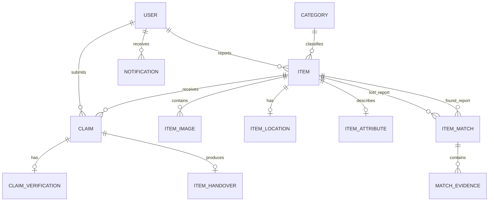

# Database Design

**Project:** Lost & Found Bangladesh
**Database:** MySQL
**ORM:** Spring Data JPA / Hibernate
**Version:** 1.0
**Status:** Existing MVP + Planned Expansion

## 1. Overview

The database stores user accounts, lost/found reports, locations, images, ownership claims, potential matches, notifications, and recovery records.

All tables use primary keys and appropriate foreign-key constraints.

Database changes must be managed through versioned migrations.

**Important:** This document defines the target schema. Existing tables and column names must be verified against the current Spring Boot entities before migrations are created.

## 2. Entity Relationship Diagram



An `ITEM_MATCH` connects exactly one LOST report with one FOUND report.

## 3. Core Tables

### 3.1 users

Stores registered user information.

| Column        | Type         | Constraint       |
| ------------- | ------------ | ---------------- |
| id            | BIGINT       | PK               |
| name          | VARCHAR(150) | NOT NULL         |
| email         | VARCHAR(255) | UNIQUE, NOT NULL |
| password_hash | VARCHAR(255) | NOT NULL         |
| phone         | VARCHAR(30)  | NULL             |
| role          | VARCHAR(30)  | NOT NULL         |
| status        | VARCHAR(30)  | NOT NULL         |
| created_at    | DATETIME     | NOT NULL         |
| updated_at    | DATETIME     | NOT NULL         |

**Roles:** `USER`, `MODERATOR`, `ADMIN`

Passwords must be stored as secure hashes.

### 3.2 categories

Stores item categories.

| Column    | Type         | Constraint                |
| --------- | ------------ | ------------------------- |
| id        | BIGINT       | PK                        |
| name      | VARCHAR(100) | NOT NULL                  |
| slug      | VARCHAR(120) | UNIQUE                    |
| parent_id | BIGINT       | FK → categories.id, NULL |
| is_active | BOOLEAN      | NOT NULL                  |

Supports hierarchical categories.

### 3.3 items

Stores lost and found reports.

| Column      | Type         | Constraint          |
| ----------- | ------------ | ------------------- |
| id          | BIGINT       | PK                  |
| reporter_id | BIGINT       | FK → users.id      |
| category_id | BIGINT       | FK → categories.id |
| type        | VARCHAR(10)  | NOT NULL            |
| title       | VARCHAR(200) | NOT NULL            |
| description | TEXT         | NOT NULL            |
| status      | VARCHAR(30)  | NOT NULL            |
| event_date  | DATE         | NOT NULL            |
| time_from   | TIME         | NULL                |
| time_to     | TIME         | NULL                |
| created_at  | DATETIME     | NOT NULL            |
| updated_at  | DATETIME     | NOT NULL            |

**Type:** `LOST`, `FOUND`

**Status:** `ACTIVE`, `MATCHED`, `RESOLVED`, `CLOSED`, `REMOVED`

A potential match does not automatically establish recovery.

### 3.4 item_images

Stores references to uploaded photographs.

| Column      | Type         | Constraint     |
| ----------- | ------------ | -------------- |
| id          | BIGINT       | PK             |
| item_id     | BIGINT       | FK → items.id |
| storage_key | VARCHAR(500) | NOT NULL       |
| is_primary  | BOOLEAN      | NOT NULL       |
| visibility  | VARCHAR(20)  | NOT NULL       |
| created_at  | DATETIME     | NOT NULL       |

Actual images should be stored in object/file storage, not directly in MySQL.

### 3.5 item_locations

Stores geographical information.

| Column                    | Type          | Constraint             |
| ------------------------- | ------------- | ---------------------- |
| id                        | BIGINT        | PK                     |
| item_id                   | BIGINT        | UNIQUE, FK → items.id |
| division                  | VARCHAR(100)  | NULL                   |
| district                  | VARCHAR(100)  | NULL                   |
| upazila                   | VARCHAR(100)  | NULL                   |
| area                      | VARCHAR(200)  | NULL                   |
| address_text              | VARCHAR(500)  | NULL                   |
| latitude                  | DECIMAL(10,7) | NULL                   |
| longitude                 | DECIMAL(10,7) | NULL                   |
| precision                 | VARCHAR(30)   | NOT NULL               |
| uncertainty_radius_meters | INT           | NULL                   |

Coordinates must satisfy:

```text
-90  <= latitude  <= 90
-180 <= longitude <= 180
```

Location precision examples:

`EXACT`, `APPROXIMATE`, `AREA_ONLY`, `UNKNOWN`

The application must protect sensitive exact locations when generating public responses.

### 3.6 item_attributes

Stores structured item characteristics.

| Column          | Type         | Constraint             |
| --------------- | ------------ | ---------------------- |
| id              | BIGINT       | PK                     |
| item_id         | BIGINT       | UNIQUE, FK → items.id |
| color           | VARCHAR(50)  | NULL                   |
| brand           | VARCHAR(100) | NULL                   |
| material        | VARCHAR(100) | NULL                   |
| attributes_json | JSON         | NULL                   |

Additional attributes may vary by item category.

## 4. Matching Tables — Planned

### 4.1 item_matches

Stores automatically generated potential matches.

| Column            | Type         | Constraint     |
| ----------------- | ------------ | -------------- |
| id                | BIGINT       | PK             |
| lost_item_id      | BIGINT       | FK → items.id |
| found_item_id     | BIGINT       | FK → items.id |
| match_score       | DECIMAL(5,2) | NOT NULL       |
| match_status      | VARCHAR(30)  | NOT NULL       |
| algorithm_version | VARCHAR(50)  | NOT NULL       |
| created_at        | DATETIME     | NOT NULL       |
| updated_at        | DATETIME     | NOT NULL       |

**Unique constraint:**

```sql
UNIQUE (lost_item_id, found_item_id)
```

Business validation must ensure:

- `lost_item_id` references a LOST report.
- `found_item_id` references a FOUND report.
- An item cannot match itself.
- Scores remain between 0 and 100.

### 4.2 match_evidence

Stores matching score explanations.

| Column           | Type         | Constraint            |
| ---------------- | ------------ | --------------------- |
| id               | BIGINT       | PK                    |
| match_id         | BIGINT       | FK → item_matches.id |
| feature_name     | VARCHAR(100) | NOT NULL              |
| similarity_score | DECIMAL(5,2) | NOT NULL              |
| weight           | DECIMAL(5,4) | NOT NULL              |
| contribution     | DECIMAL(6,3) | NOT NULL              |

Example features:

`CATEGORY`, `TITLE`, `DESCRIPTION`, `ATTRIBUTES`, `LOCATION`, `TIME`

## 5. Claim and Recovery Tables

### 5.1 claims

Stores ownership claims.

| Column      | Type        | Constraint     |
| ----------- | ----------- | -------------- |
| id          | BIGINT      | PK             |
| item_id     | BIGINT      | FK → items.id |
| claimant_id | BIGINT      | FK → users.id |
| status      | VARCHAR(30) | NOT NULL       |
| created_at  | DATETIME    | NOT NULL       |
| updated_at  | DATETIME    | NOT NULL       |

Suggested statuses:

`PENDING`, `UNDER_REVIEW`, `VERIFIED`, `REJECTED`, `WITHDRAWN`

The existing Claim entity and its relationships should be preserved where appropriate.

### 5.2 claim_verifications — Planned

Stores claim verification results.

| Column              | Type        | Constraint              |
| ------------------- | ----------- | ----------------------- |
| id                  | BIGINT      | PK                      |
| claim_id            | BIGINT      | UNIQUE, FK → claims.id |
| verification_method | VARCHAR(50) | NOT NULL                |
| verification_status | VARCHAR(30) | NOT NULL                |
| reviewed_by         | BIGINT      | FK → users.id, NULL    |
| verified_at         | DATETIME    | NULL                    |

Private verification evidence requires restricted storage and access.

### 5.3 item_handovers — Planned

Stores recovery and handover information.

| Column          | Type        | Constraint              |
| --------------- | ----------- | ----------------------- |
| id              | BIGINT      | PK                      |
| claim_id        | BIGINT      | UNIQUE, FK → claims.id |
| item_id         | BIGINT      | FK → items.id          |
| handover_method | VARCHAR(50) | NOT NULL                |
| handover_status | VARCHAR(30) | NOT NULL                |
| completed_at    | DATETIME    | NULL                    |
| created_at      | DATETIME    | NOT NULL                |

Suggested statuses:

`PENDING`, `ARRANGED`, `COMPLETED`, `CANCELLED`, `DISPUTED`

## 6. Supporting Tables

### 6.1 notifications

| Column       | Type         | Constraint     |
| ------------ | ------------ | -------------- |
| id           | BIGINT       | PK             |
| recipient_id | BIGINT       | FK → users.id |
| type         | VARCHAR(50)  | NOT NULL       |
| title        | VARCHAR(200) | NOT NULL       |
| message      | TEXT         | NOT NULL       |
| data         | JSON         | NULL           |
| is_read      | BOOLEAN      | NOT NULL       |
| created_at   | DATETIME     | NOT NULL       |

### 6.2 abuse_reports — Planned

| Column      | Type        | Constraint     |
| ----------- | ----------- | -------------- |
| id          | BIGINT      | PK             |
| reporter_id | BIGINT      | FK → users.id |
| target_type | VARCHAR(30) | NOT NULL       |
| target_id   | BIGINT      | NOT NULL       |
| reason      | TEXT        | NOT NULL       |
| status      | VARCHAR(30) | NOT NULL       |
| created_at  | DATETIME    | NOT NULL       |

### 6.3 audit_logs — Planned

| Column      | Type         | Constraint           |
| ----------- | ------------ | -------------------- |
| id          | BIGINT       | PK                   |
| actor_id    | BIGINT       | FK → users.id, NULL |
| action      | VARCHAR(100) | NOT NULL             |
| entity_type | VARCHAR(50)  | NOT NULL             |
| entity_id   | BIGINT       | NULL                 |
| metadata    | JSON         | NULL                 |
| created_at  | DATETIME     | NOT NULL             |

## 7. Database Indexes

Recommended indexes:

```sql
CREATE INDEX idx_items_type_status
ON items (type, status);

CREATE INDEX idx_items_category
ON items (category_id);

CREATE INDEX idx_items_event_date
ON items (event_date);

CREATE INDEX idx_items_reporter
ON items (reporter_id);

CREATE INDEX idx_locations_lat_lng
ON item_locations (latitude, longitude);

CREATE INDEX idx_matches_lost
ON item_matches (lost_item_id);

CREATE INDEX idx_matches_found
ON item_matches (found_item_id);

CREATE INDEX idx_claims_claimant_status
ON claims (claimant_id, status);
```

Indexes must be introduced only after verifying existing schema and migration history.

For larger geographic datasets, evaluate MySQL spatial columns and indexes rather than relying solely on separate latitude and longitude indexes.

## 8. Data Integrity Rules

1. Every item must belong to an existing user.
2. Every claim must reference an existing item and claimant.
3. Match records must connect opposite report types.
4. Duplicate match pairs are prohibited.
5. Users cannot modify reports they do not own unless authorized.
6. Resolved reports must not accept incompatible state transitions.
7. Sensitive ownership evidence must not be publicly exposed.
8. Item deletion should preserve required recovery and audit history according to retention policies.
9. Database writes involving multiple related entities should use transactions.

## 9. Database Migrations

Use a migration framework such as Flyway.

Suggested location:

```text
src/main/resources/db/migration/
```

Example:

```text
V1__initial_schema.sql
V2__add_item_locations.sql
V3__add_item_attributes.sql
V4__add_item_matches.sql
V5__add_recovery_tables.sql
```

These filenames are illustrative; migration versions must follow the actual database history.

Do not recreate or overwrite production tables containing existing data.

For migration-controlled environments, use Hibernate schema validation instead of automatic production schema updates.

## 10. Related Documentation

| Document               | Purpose                                |
| ---------------------- | -------------------------------------- |
| `03-ARCHITECTURE.md` | Application architecture               |
| `05-API.md`          | Request/response contracts             |
| `06-CODEBASE.md`     | Entity and repository responsibilities |
| `07-SMARTMATCH.md`   | Matching engine                        |
| `08-SECURITY.md`     | Data protection                        |
